<p align="center">
  
</p>

<h1 align="center">Pliqra</h1>
<p align="center"><strong>Know what you connect to.</strong><br>Discover capabilities. Verify behavior. See when your service contract changes.</p>
<p align="center">
  <a href="https://github.com/etrkk5/pliqra/actions/workflows/test.yml"></a>
  · <a href="#run-pliqra-in-two-minutes">Quick start</a>
  · <a href="#see-pliqra-in-action">Screenshots</a>
  · <a href="#how-it-fits-together">Architecture</a>
  · <a href="docs/PROTOCOL.md">Protocol</a>
</p>

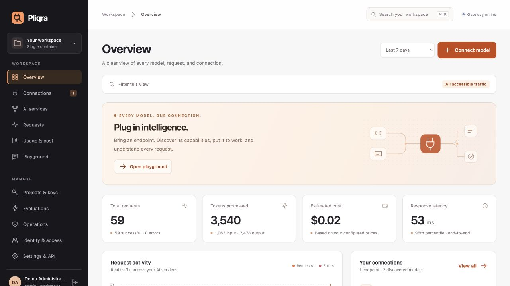

**Know the agreement. See when it changes.**

Bring a running model endpoint. Pliqra shows what it advertises, records what has actually been verified, and gives your application an explicit connection contract. When service policy or advertised model metadata changes, a stale binding is rejected with HTTP 409 and the overview shows how many application identities need to reconnect to the selected service.

The first-use path is **connect an endpoint → make a real call → connect your application**. Administrators can create a service-scoped key and binding together in the connection dialog; existing keys remain supported. Workspace identity, evaluations, operations and other advanced controls stay available under **Advanced tools**. The OpenAI-compatible API works without an explicit binding when that is all you need.

Everything runs in **one Docker image**: the console, management API, gateway, reporting and persistent storage. No Kubernetes, external database, identity server or frontend build pipeline is required for a local setup. Connect standards-compatible company identity when you need it.

## What changes with Pliqra

| What you want | What Pliqra gives you |
|---|---|
| **An endpoint that is ready to use** | Discover models, create stable service names automatically, and make the first call from the playground. Manual registration handles endpoints without discovery. |
| **A clear agreement with a model** | Discover capabilities, bind requirements to a fingerprinted contract, and receive an explicit `409` when the contract changes. |
| **Evidence of what actually works** | Keep declared capabilities separate from real chat, streaming, JSON Schema and function-call probes. Compare services against your own task examples. |
| **An explanation for every request** | Inspect the route, each upstream attempt, fallback reason, first-token latency, reported consumption and estimated cost. Unknown usage stays visible. |
| **Team autonomy with central visibility** | Give projects and teams scoped access while administrators retain a cumulative view, detailed filters and complete CSV exports. |
| **A small operational footprint** | One self-hosted image, offline browser assets, encrypted secrets, optional federation, backup/restore and local recovery tools. |

Pliqra's core idea is **an inspectable connection contract**: discovery → capability requirements → binding → invocation → execution evidence. The protocol is implemented and independently demonstrated; it remains a draft, with no claim of industry-standard adoption.

## Run Pliqra in two minutes

Prerequisites: Docker with Compose and an already running model endpoint.

```sh
git clone https://github.com/etrkk5/pliqra.git
cd pliqra
docker compose up --build -d
```

Open **http://localhost:8088**, create your administrator account, and connect a model endpoint. No default password, demo account or sample traffic is shipped.

Follow the three cards on **Overview**. Progress comes from retained successful inference records and current, unexpired bindings, independently of reporting filters. The contract panel separates declared capabilities from observed verification. No inference or paid probe runs automatically during onboarding.

Prefer a single Docker command sequence?

```sh
docker build -t pliqra:1.1.0 .
docker run -d --name pliqra \
  -p 127.0.0.1:8088:8080 \
  -v pliqra-data:/data \
  --add-host host.docker.internal:host-gateway \
  --restart unless-stopped \
  pliqra:1.1.0
```

Open http://localhost:8088, create your administrator, then **Connect model**. Supply a running OpenAI-compatible or Ollama endpoint. Models become stable named AI services automatically. A manual model name handles servers without model-list discovery. No accounts, credentials, or sample traffic are seeded.

Copy `.env.example` to `.env` for optional Compose settings. `PLIQRA_HTTP_PORT` changes its default host port of 8088. The Compose deployment persists `pliqra-data`; the standalone command above uses the same volume name. To stop Compose use `docker compose down`; preserve the volume to keep the workspace.

The endpoint must be reachable **from inside the container**. Use `http://host.docker.internal:PORT` for a host service, or a container hostname on a shared Docker network. `localhost` inside Pliqra is Pliqra itself.

## How it fits together

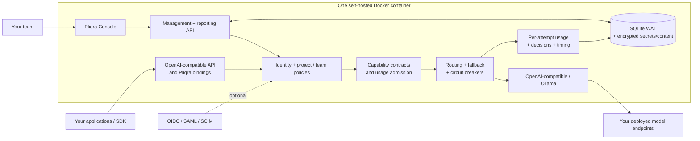

**Request flow:** authenticate → check service access and contract → admit against limits/budget → choose an eligible deployment → stream or return the response → record execution evidence.

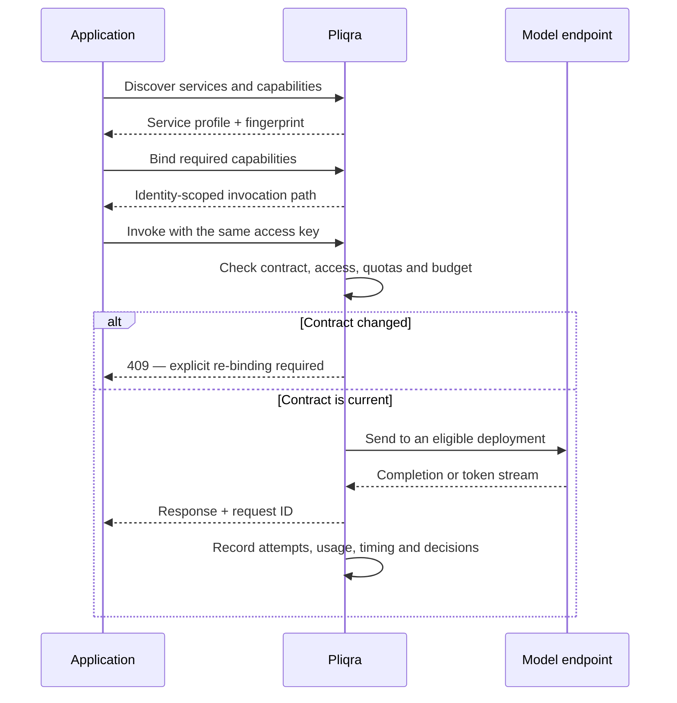

Ordinary `/v1/chat/completions` calls can skip the explicit binding step. Fallback occurs only before streaming starts. See [the technical architecture](docs/ARCHITECTURE.md) for component boundaries, onboarding, authorization, accounting, recovery and the source map.

## See Pliqra in action

All screenshots come from the actual running console in an isolated demonstration workspace. Models and traffic are clearly synthetic; no production accounts, provider secrets or private prompts are shown.

### From endpoint to a stable service

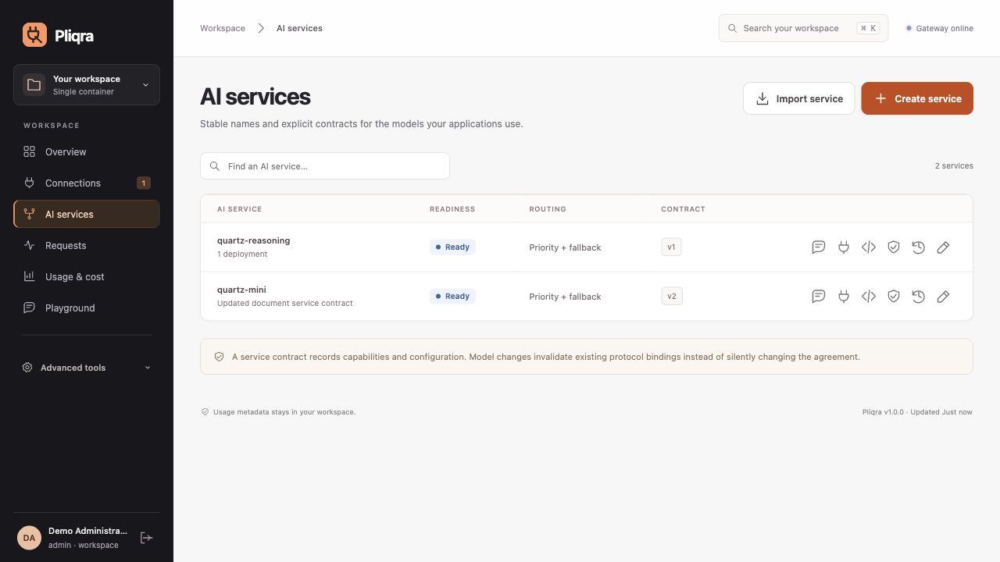

### Negotiate the application's connection

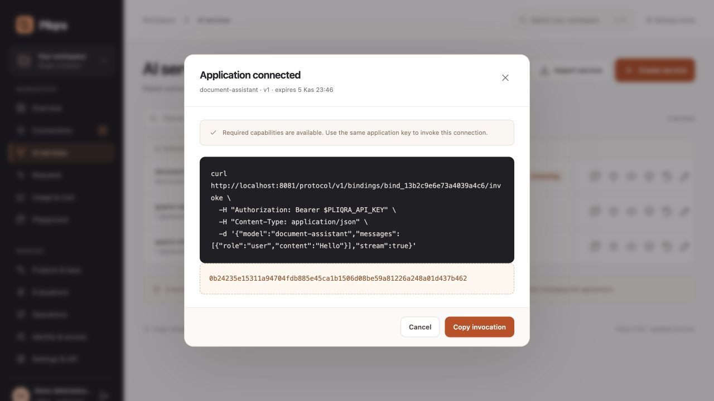

### See when an application needs to reconnect

The selected service shows active application identities whose contract no longer matches. A fresh binding for the same identity clears its renewal notice. Revoked credentials, expired bindings and identities that lost access do not count as active connections. Drift detection covers service configuration and advertised model metadata; undisclosed model-weight changes behind an unchanged endpoint cannot be inferred.

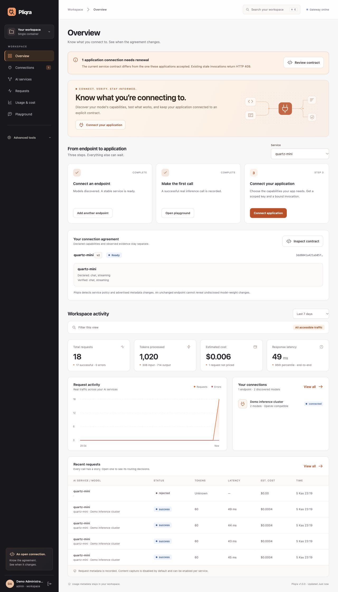

### Follow the request all the way through

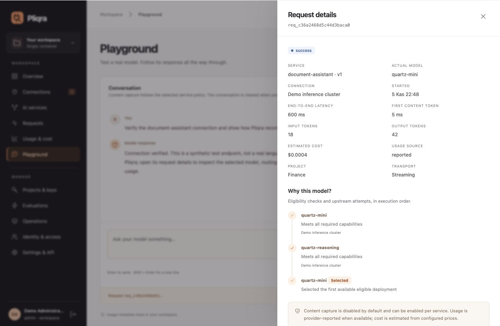

<details>
<summary>Team attribution and individual model attempt accounting</summary>

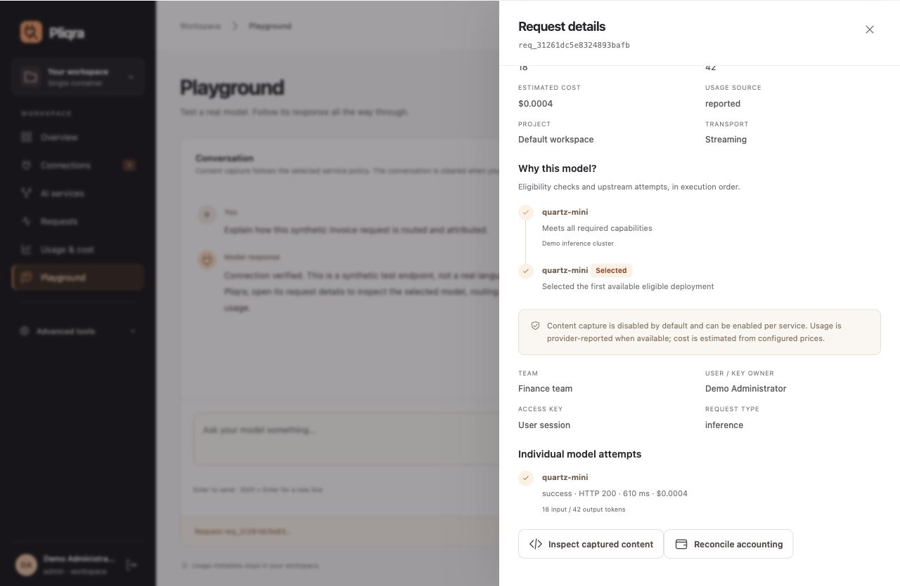

</details>

### Give administrators a cumulative and team-level view

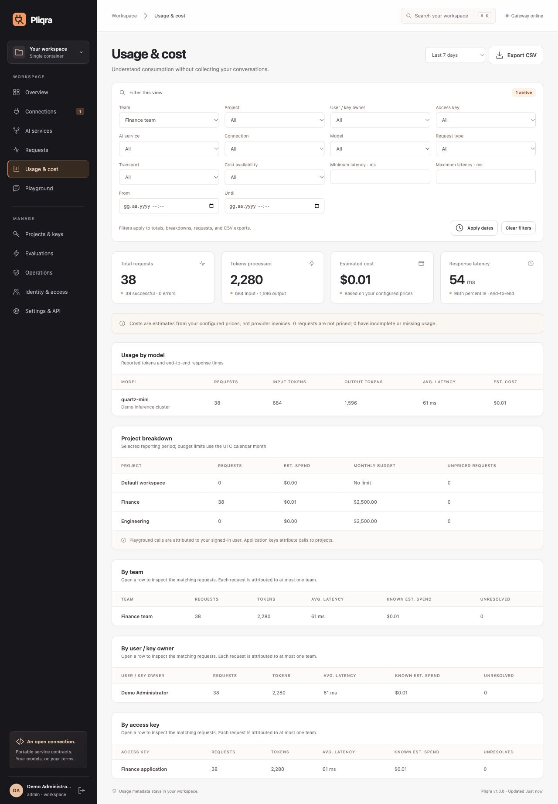

### Test the endpoint before connecting your application

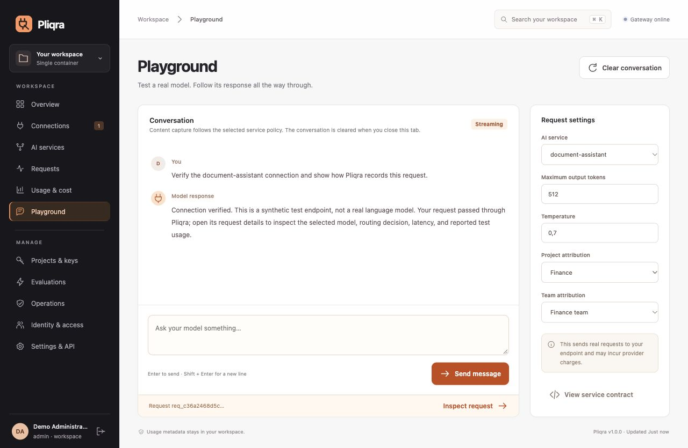

## Build a gateway for each workload

Pliqra now brings the model-as-a-service catalog, inference routing, identity, quotas and guardrail execution into one console. Administrators can publish separate gateways for teams or applications, each with its own address and versioned policy. Keys assigned to a gateway enforce its policy on every inference path.

- Combine request and token quotas across independent rolling windows and gateway, key, user/owner, project, team or service scopes.
- Set concurrent-request, input/output and capability controls while retaining service routing, key RPM limits and project budgets.
- Chain local checks, NVIDIA NeMo check-API providers and custom HTTP validators before inference and before output delivery. Choose enforcement or observation and an explicit failure policy per step.
- Preview admission without inference, try the gateway in the playground, issue scoped keys, inspect decisions, clone policies, export/import definitions and restore prior versions.


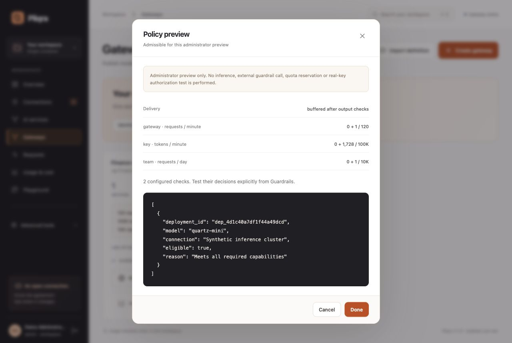

See [the gateway and guardrail guide](docs/GATEWAYS.md) for configuration, APIs, architecture, quota accounting, streaming and the exact NeMo compatibility boundary. External engines remain optional services; Pliqra itself still runs in one container.

## Capabilities

| Area | Supported behavior |
|---|---|
| Connections | Discovery, manual registration, custom authentication header/prefix, credential rotation, enable/disable, scheduled health checks and inventory drift alerts |
| AI services | Stable names, priority/fallback and round-robin routing, capability requirements, project access, input/output limits, exact encrypted cache, configuration preview, version history and rollback |
| Evidence | Declared capabilities separate from actual verification; explicit chat, streaming, function-call and JSON Schema probes; metadata drift resets verification |
| Named gateways | Versioned service catalogs, project/team restrictions, rolling request/token quotas, six quota scopes, concurrency, inference controls, clone/export/import, preview and policy-aware keys |
| Guardrails | Ordered input/output chains; local phrase/PII/schema checks; NeMo check-API and custom HTTP decision providers; enforce/observe; explicit error policy; per-request verdicts; guarded SSE delivery |
| Applications | OpenAI-compatible model list and chat completions, streaming, scoped/expiring/revocable keys, key rotation, RPM, project concurrency and budget admission |
| Access | Local accounts; workspace administrators; direct project memberships; teams with member/manager grants; OIDC with PKCE; SAML 2.0; provider-scoped SCIM user/group provisioning and deprovisioning |
| Reporting | Workspace totals and team/project/user/key/service/model breakdowns; custom time, status, latency, transport, connection and request-type filters; paginated requests; complete filtered CSV export |
| Request details | Routing decisions, each fallback attempt, HTTP status, timing, first-token latency, reported tokens, known/unknown cost and operator reconciliation |
| Content | Off by default. Per-service opt-in encrypted request/response capture, administrator-only inspection, audited reads and deletion, 64 KB limit per side |
| Evaluations | Saved task examples, expected text/JSON structure/latency checks, comparisons across services, explicit execution, optional saved outputs, cancellation and deletion |
| Operations | Runtime limits, retention, drift notifications, encrypted backup/restore, offline recovery commands, protected Prometheus metrics and audit history |
| Portability | Credential-free export/import with local deployment mapping, fingerprinted discovery/binding/invoke protocol, dependency-free Python client and independent reference server |

All supported configuration is available through the interface and `/api/v1/*`. `/openapi.json` describes the API; **Settings & API** displays operations offline and offers the Python client and protocol specification for download. The dashboard requires no external fonts, scripts, analytics, or CDN.

For automation, `GET /api/v1/getting-started?service_id=...` exposes the same scoped onboarding state. Administrators can use `POST /api/v1/application-connections` to create a service-restricted key and binding atomically. Failed capability negotiation leaves no orphan key. The generated key permits 60 requests/minute, expires after 90 days, and is returned only once; the binding lifetime is independently configurable.

## Administrator visibility

Administrators can inspect and manage all workspace resources and all retained request history, including cumulative totals and each team's traffic. Filters apply consistently to the dashboard, request list, rollups and CSV. **All retained history** removes the rolling reporting window; runtime retention determines how much history is stored.

Project managers see requests belonging to their managed projects and their own calls. Project members see their own calls and the services granted to their projects. Workspace administration, identity configuration, provider credentials, keys, backups, raw captured content and billing corrections remain administrator functions. Incoming SSO claims never grant workspace administrator status automatically.

Application keys have a fixed project, optional team, and optional service allow-list. Requests cannot override key billing attribution. User/playground requests can choose an accessible project and team; project-scoped services enforce their project automatically. User/key-owner breakdowns identify the key creator, not an inferred downstream human.

## Call a service

Create an access key in **Projects & keys**. Its complete value is shown once. Use an **AI service name**, not the underlying deployment name:

```sh
export PLIQRA_API_KEY='your-key'
curl http://localhost:8088/v1/chat/completions \
  -H "Authorization: Bearer $PLIQRA_API_KEY" \
  -H 'Content-Type: application/json' \
  -d '{"model":"your-service","messages":[{"role":"user","content":"Hello"}],"stream":true}'
```

`X-Request-ID` links to the corresponding request record; `X-Pliqra-Model` identifies the selected deployment model. Fallback applies to connection failures and HTTP 429/502/503/504 **before streaming starts**. A started stream is never silently replayed. Missing completion markers are recorded as incomplete. Client cancellation closes the upstream connection; stopping provider-side computation is best effort.

The independent Python client is in `sdk/pliqra_client.py`:

```python
from pliqra_client import Pliqra

client = Pliqra("http://localhost:8088", api_key)
connection = client.connect("your-service", ["chat", "streaming"])
result = connection.complete([{"role": "user", "content": "Hello"}])
# Contract changes raise ContractChanged (HTTP 409); explicitly discover/bind again.
```

See [the protocol](docs/PROTOCOL.md) for the handshake, portability boundary, and independent server. Product version 1.1 and protocol draft 0.1 have separate lifecycles. This is an implemented draft, not an established industry standard.

## Identity setup

**OIDC:** connect the issuer URL, client ID and secret in **Identity & access**, and register the callback shown by the interface. ID tokens are validated; accounts are keyed by connector and stable subject, not merged by email. Use the provider editor for the stable-subject and groups claim names. New federated accounts are viewers.

**SAML:** configure the IdP entity ID, SSO URL and signing certificate. Register Pliqra's generated SP metadata with the IdP. The SP signs login requests and requires signed assertions, valid audience/destination/time, a matching request, a browser-bound relay cookie and replay protection. Use an **HTTPS public URL** and secure cookies for SAML's cross-site response. Unsolicited IdP-initiated login and SAML single logout are not supported.

**SCIM:** enable a provisioning token on the intended connector and register its displayed `/scim/v2/{provider_id}` URL. Match SCIM `externalId` to the configured stable SSO subject. Enabling SCIM requires provisioning before sign-in and revokes existing sessions. Tokens are provider-scoped. Users, groups, equality filtering, pagination, replace/update, group membership and disabling users are supported. Bulk operations, sorting, ETags and vendor-specific extensions are not. Map trusted SSO/SCIM groups to project member/manager grants explicitly.

Implementations follow [SCIM's protocol](https://www.rfc-editor.org/rfc/rfc7644.html) and use the [SAML Python toolkit](https://github.com/SAML-Toolkits/python3-saml) for signature and assertion validation. OIDC and SAML are verified with controlled signed fixtures; compatibility with an organization's actual IdP must be checked using its configuration. There is no claim that every vendor/extension has been tested.

## HTTPS and storage

Persist the whole `/data` volume. It contains SQLite/WAL data and `encryption.key`; neither alone is a complete recovery copy. Provider secrets, SAML private keys, optional captured content and cached responses use authenticated encryption. Keys and sessions are stored as hashes; passwords use salted scrypt. Startup refuses a missing/mismatched encryption key and a second process sharing the same volume.

| Variable | Default | Purpose |
|---|---|---|
| `PLIQRA_DATA_DIR` | `data` locally; `/data` in Docker | Persistent directory |
| `PLIQRA_HOST` / `PLIQRA_PORT` | `0.0.0.0` / `8080` | Listener |
| `PLIQRA_PUBLIC_URL` | Request base URL | Exact public origin for redirects, CSRF and federation |
| `PLIQRA_SECURE_COOKIES` | `0` | Set `1` for HTTPS |
| `PLIQRA_ENCRYPTION_KEY` | Generated persistent key | Optional externally managed Fernet key; preserve it |
| `PLIQRA_TLS_CERTFILE` / `PLIQRA_TLS_KEYFILE` | Unset | Native HTTPS certificate and private-key file paths |

HTTPS can use the native TLS settings with mounted certificate files, or your existing reverse proxy. Configure the exact public URL and secure cookies. Forwarded headers are not trusted automatically. The default loopback port mapping is intended for local setup; create the administrator before exposing the instance to a wider network.

## Backup and recovery

In **Operations**, download a password-encrypted backup and keep its password separately. It includes a consistent database snapshot and its encryption key. Restore requires typing `RESTORE`, no active inference/evaluation, and signs everyone out. A local pre-restore snapshot and crash marker recover an interrupted restore. When `PLIQRA_ENCRYPTION_KEY` is externally supplied, it must match the archive's key.

The following offline commands work for the Compose installation. Stop the service first; the temporary recovery container automatically uses the same volume and non-root user. Passwords are entered interactively:

```sh
docker compose stop pliqra
docker compose run --rm --no-deps pliqra python -m pliqra check
docker compose run --rm --no-deps pliqra python -m pliqra backup --file /data/workspace.mpb
docker compose run --rm --no-deps pliqra python -m pliqra restore --file /data/workspace.mpb
docker compose run --rm --no-deps pliqra python -m pliqra reset-password --email owner@example.com
docker compose up -d pliqra
```

Change an account's own password in **Settings & API**. Administrators can revoke member sessions and rotate application, provisioning and monitoring tokens. At least one active local administrator must remain.

## Usage and operating limits

Costs are configured-price **estimates**, not invoices. Each attempted upstream call is accounted separately. Missing provider usage or pricing remains unknown, including partially known fallback totals. Budgeted calls require pricing and atomically reserve a conservative allowance for possible attempts. Unknown charges keep the remaining reservation until an administrator reconciles them, with an audit note. Budgets use UTC calendar months and do not guarantee final provider billing. Cached calls use zero upstream billable tokens; the returned cached response retains its original provider usage and includes `pliqra.cache_hit`.

Runtime retention defaults to 90 days and cannot be shorter than 32 days, preserving current-month budgets. Pending requests and unresolved reservations are retained. Captured content follows its request's retention; test sets and explicitly saved evaluation outputs remain until deleted. Prometheus `/metrics` uses a separate monitoring bearer token created in **Operations**.

The supported deployment is **one workspace, one process, one persistent volume**. Project isolation is authorization inside that workspace; it is not separate physical tenants. Horizontal scaling, distributed quotas and PostgreSQL are not in this release. Chat completions are a supported subset: no multi-choice `n>1`, Responses API, embeddings, audio, model training or model deployment management. OpenAI-compatible function calling/structured output is supported; native Ollama tool-loop/stream shapes require adapter-specific conformance before use. Gateway policies compose local, NeMo check-API and custom HTTP guardrails; local patterns are not a complete DLP or semantic safety engine.

## Upgrading from the earlier Model Port build

Pliqra is the new name across the application, Python package, SDK, environment variables, response headers and protocol discovery. The canonical entry points are `python -m pliqra`, `sdk/pliqra_client.py`, `PLIQRA_*`, `X-Pliqra-*` and `/.well-known/pliqra`.

Before upgrading, take an encrypted backup, stop the old container, and attach its existing data volume to Pliqra. The database is checkpointed and atomically renamed from `modelport.sqlite3` to `pliqra.sqlite3`; accounts, services, keys, history and encrypted credentials are retained. An ambiguous volume containing both database names is rejected. Keep the encryption key with its volume.

Existing encrypted backups and portable service exports remain importable. Existing hashed application keys remain valid. Browser sessions should sign in again after the rename. Legacy `MODELPORT_*` environment variables are accepted as a fallback where the corresponding canonical variable is not set; update deployment settings to `PLIQRA_*` explicitly, including Docker/Compose environment values.

For an existing standalone installation using the old volume name:

```sh
docker stop modelport
docker run -d --name pliqra \
  -p 127.0.0.1:8088:8080 \
  -v modelport-data:/data \
  --add-host host.docker.internal:host-gateway \
  --restart unless-stopped pliqra:1.1.0
```

The volume name is an existing storage reference, not the product name. Do not run the old and new processes on the same volume simultaneously. Restore the pre-upgrade backup before returning to the old build.

## Development and validation

Python 3.13+:

```sh
python3 -m venv .venv
.venv/bin/pip install -r requirements-dev.txt
.venv/bin/python -m pytest -q
PLIQRA_DATA_DIR=./data .venv/bin/python -m pliqra
```

Tests use isolated temporary databases and synthetic upstreams. They exercise inference, fragmented/incomplete streams, fallback, contract invalidation, credentials, scopes, quotas, budgets, team reporting, encrypted capture/cache/backup, restore, SCIM lifecycle, signed/tampered/replayed SAML, and actual asynchronous evaluations. `tests/mock_provider.py` is explicitly synthetic and excluded from the production image. It is never launched by the product.

See [release validation](docs/RELEASE.md) for measured evidence and [future scope](docs/ROADMAP.md) for additions beyond this release.
