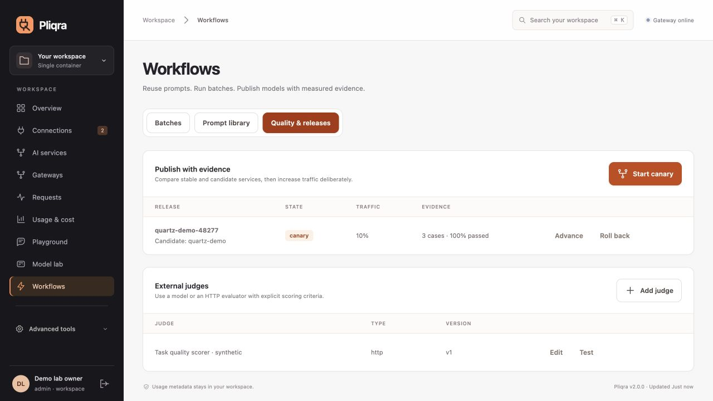

<p align="center">
  
</p>

<h1 align="center">Pliqra</h1>
<p align="center"><strong>Plug in models. Publish your rules. Keep the contract.</strong><br>Turn a model endpoint into an AI service with an explicit connection contract.</p>
<p align="center">
  <a href="https://github.com/etrkk5/pliqra/actions/workflows/test.yml"></a>
  · <a href="#quick-start">Quick start</a>
  · <a href="docs/CONSOLE.md">Console tour</a>
  · <a href="docs/ARCHITECTURE.md">Architecture</a>
  · <a href="docs/PROTOCOL.md">Protocol</a>
</p>

**Bring an endpoint. Publish a gateway. Keep the agreement visible.**

Pliqra combines a model-as-a-service catalog, inference routing, custom gateway policies and guardrails in one self-hosted application. Configure it through the console or API, then connect your applications with scoped keys.



## What Pliqra brings

| Capability | What you get |
|---|---|
| **Explicit model contracts** | Separate declared capabilities from verified behavior. Bind applications to a fingerprint; changed contracts require explicit renewal with HTTP 409. |
| **A gateway for every workload** | Publish selected services with project/team access, request and token quotas, rolling windows, budgets and concurrency controls. Assigned keys enforce their gateway policy across inference paths. |
| **Composable guardrails** | Chain local checks, NeMo check-API providers and custom HTTP validators on input/output. Enforce or observe; apply local redaction and inspect recorded verdicts. |
| **An explanation for every call** | Follow routing, fallback attempts, guardrail decisions, timing, tokens and estimated costs. Administrators see cumulative totals and team-level detail. |
| **Publish with evidence** | Version prompts, queue durable batches, compare models with external judges, and gate canary releases on fresh quality evidence. |
| **One policy across interfaces** | Chat, embeddings, speech/transcription, Responses, Messages and Ollama through the same admission and accounting boundary. |
| **Start small, share state when needed** | One Docker image by default. Optional PostgreSQL and active/active data centers with exact shared quotas, local model preference, site draining, isolated organizations and analytics. |
| **Identity without platform lock-in** | OIDC/SAML/SCIM, signed logout, short-lived workload identities and environment/file/Vault secret references. |

## Quick start

With Docker Compose and a running model endpoint:

```sh
git clone https://github.com/etrkk5/pliqra.git
cd pliqra
docker compose up --build -d
```

Open **http://localhost:8088**, create your administrator, then follow **connect endpoint → make a real call → connect application**. Your workspace starts empty; the model endpoint must be reachable from inside the container.

[Installation & first call →](docs/GETTING_STARTED.md) · [Two-replica installation →](docs/PLATFORM.md#start-two-gateways)

## Go deeper

| Guide | Contents |
|---|---|
| [Gateways & guardrails](docs/GATEWAYS.md) | Policy builder, quota scopes, check providers, guarded streaming, APIs and request flow |
| [Console tour](docs/CONSOLE.md) | Model onboarding, contracts, request inspection, team reporting and gateway screenshots |
| [Identity & access](docs/ACCESS.md) | Administrator visibility, project/team grants, OIDC, SAML and SCIM |
| [Operations & recovery](docs/OPERATIONS.md) | Configuration, HTTPS, storage, backups, upgrades and operating limits |
| [Architecture](docs/ARCHITECTURE.md) | Components, lifecycle diagrams, authorization, accounting and source map |
| [Connection protocol](docs/PROTOCOL.md) | Discover, bind and invoke; independent SDK and reference server |
| [Capability reference](docs/CAPABILITIES.md) | Full feature matrix and management API entry points |
| [Prompts, batches & releases](docs/WORKFLOWS.md) | Immutable prompts, durable execution, external judges and canary gates |
| [Model interfaces](docs/MODEL_INTERFACES.md) | Embeddings, audio and native API compatibility boundaries |
| [Active/active data centers](docs/MULTI_DC.md) | Shared quota authority, local routing, DC drain and safe recovery |
| [Scale & organizations](docs/PLATFORM.md) | PostgreSQL, distributed admission, isolated workspaces and analytics |
| [Identity compatibility](docs/IDENTITY_COMPATIBILITY.md) | Real Keycloak evidence, vendor profiles, workload trust and secret sources |
| [Clients & conformance](docs/CONFORMANCE.md) | Python, JavaScript/TypeScript, Go and an executable protocol profile |
| [Technical architecture review](docs/TECHNICAL_REVIEW.md) | Findings, corrected designs, regression evidence and deployment boundaries |
| [Validation & scope](docs/RELEASE.md) | Automated/runtime evidence, exercised flows and operating limits |

**Current release: 2.1.0.** The default remains a single container. Protocol draft 0.1; native APIs are documented subsets. [Roadmap delivery](docs/ROADMAP.md) separates implemented scope from external vendor acceptance and ecosystem adoption.
