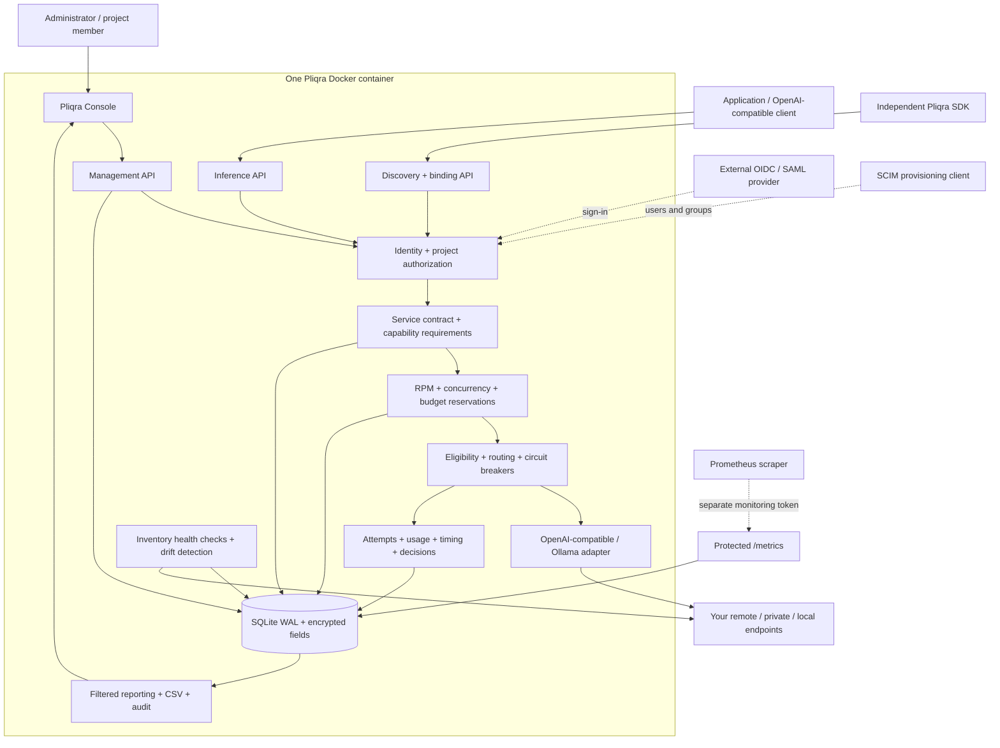
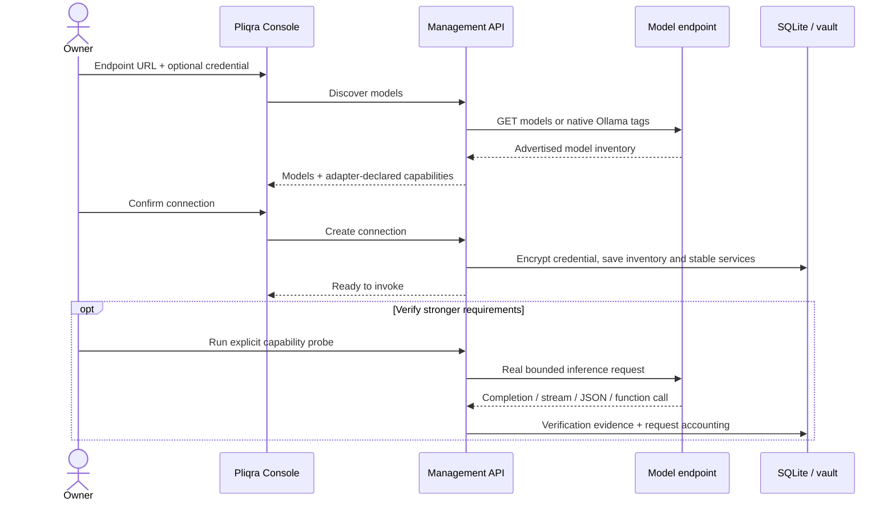
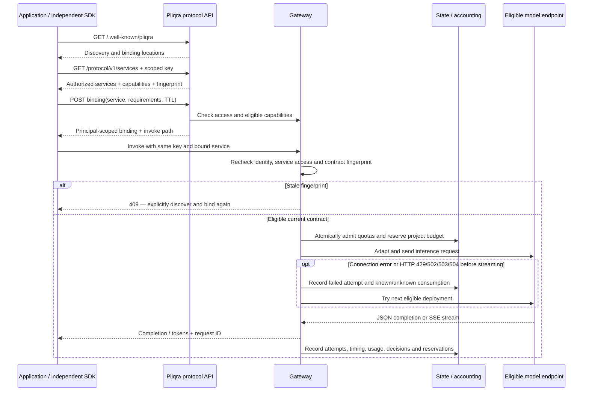
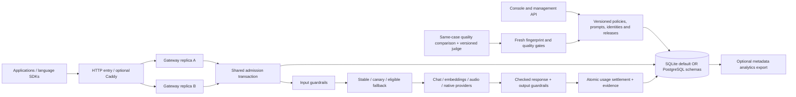

# Pliqra architecture

Pliqra connects applications to already deployed model endpoints. It discovers the endpoint, creates stable service names, negotiates capability contracts when requested, applies access and usage policies, and records the execution. It does not deploy or train model weights.

## A single deployable unit

The logical boxes share one Python process. The management API and static UI are served by FastAPI/Starlette. The gateway uses an asynchronous HTTPX client with connection reuse and redirects disabled. SQLite runs in WAL mode; a process lease prevents two Pliqra processes sharing a volume. The volume also stores its encryption key. No external database, identity server or frontend asset service is required for a local deployment.

External OIDC/SAML, SCIM and metrics integrations are optional. OIDC/SAML authenticate people; application API keys authenticate inference clients. An inference key cannot administer the workspace. `/metrics` uses a distinct monitoring token.

## The primary user path

Overview leads through endpoint connection, a real successful call, and an application contract. Its state is permission-scoped and independent of report filters. The same `/api/v1/getting-started` endpoint is available to automation. The optional administrator convenience route `/api/v1/application-connections` creates a key restricted to one service and negotiates its binding in one database transaction; a failed negotiation rolls back the key and its audit writes. Existing keys can still bind directly through the protocol endpoint.

The overview surfaces unresolved advertised-inventory notices and application identities whose contracts need renewal. A fresh current binding resolves the renewal notice for that identity; old stale invocation paths continue to return 409. Expired or revoked credentials do not count as active application connections. Advanced administration remains accessible through the collapsed sidebar section.

## Endpoint onboarding

Discovery itself does not issue inference. The operator can register a model manually if inventory discovery is unavailable. An endpoint and credentials must be reachable from inside the container. Verification probes and evaluations are explicit operations that can incur provider charges.

## Discover → bind → invoke → observe

Plain OpenAI-compatible calls to `/v1/chat/completions` are available immediately; an explicit binding is optional. Binding adds a contract with identity, required capabilities, a fingerprint and expiry. It is not a credential, a model-weight checksum or a guarantee of equivalent model quality.

The fingerprint covers the service policy, deployment configuration and advertised metadata. It excludes credentials and transient health. Undisclosed upstream weight changes cannot be detected just from an unchanged endpoint and model identifier. Metadata drift resets capability verification. A successful chat call does not verify tools, vision or JSON Schema behavior.

No fallback or automatic replay occurs once streaming has started. Missing terminal markers produce an incomplete record; cancellation closes the upstream connection and frees local capacity. Provider-side compute cancellation is best effort.

## Named gateways and guardrails

Administrators can define multiple named gateways over the existing stable-service catalog. The policy layer adds service selection, project/team restrictions, composable request/token windows, concurrency, inference controls and ordered input/output checks. Assigned keys enforce the same policy on standard, named and protocol inference routes. Existing service/key/project admission remains active.

Gateway admission and budget/key checks share one storage transaction (SQLite locally, PostgreSQL with a schema-specific advisory lock across replicas). A separate durable ledger reserves tokens across possible attempts and retains up to 30 days independently of reporting retention. Reported usage settles reservations; uncertain usage stays reserved until window expiry or audited reconciliation. Restarted requests release concurrency but preserve uncertain token charges.

Each accepted request carries a gateway fingerprint and a coherent guardrail configuration snapshot. Gateway or referenced check updates invalidate bound contracts. Input-only checks preserve upstream streaming. Output checks use a complete non-streaming upstream response, then run the output chain before emitting JSON or compatible buffered SSE. Verdict records exclude checked content and remote response text.

The NeMo adapter calls the check API; the custom HTTP contract allows other validators behind a small adapter. External engines are optional separate services. See [managed gateways](GATEWAYS.md) for the sequence diagram, API, configuration, compatibility and accounting boundaries.

## Authorization and attribution

| Identity | Services | Request history | Administration |
|---|---|---|---|
| Workspace administrator | All | All retained requests, all team/project/user/key filters | All supported management operations |
| Project manager | Granted project services and shared services | Own calls plus managed project traffic | Workspace administration stays with administrators |
| Project member | Granted project services and shared services | Own calls | Own local password |
| Application key | Fixed project and optional service allow-list | Inference response metadata | No management API access |

A request has at most one attributed team, so team rollups do not double count calls. Application attribution is fixed by the key. Session/playground attribution is checked against the selected project and team grants. “User / key owner” identifies the signed-in person or key creator; it does not infer downstream humans behind a shared application key.

## Accounting, privacy and recovery

Every attempted upstream call has its own record. The event total includes all attempts and distinguishes reported, partial, unknown and reconciled usage. Prices are configured estimates, not invoices. Unknown provider charges retain remaining budget reservations until an audited operator reconciliation.

Exact response caching is optional, encrypted, scoped to caller and contract, and bypassed for tools, streaming and evaluations. Content logging is disabled by default. An enabled service stores bounded encrypted request/response content; only administrators can inspect it and every read is audited.

A password-encrypted backup contains a consistent SQLite snapshot and its encryption key. Restore runs only without active inference/evaluations and invalidates sessions. A local snapshot and recovery marker roll back an interrupted restore. External encryption keys must match the archive. Store the whole data volume, not just a running database file.

## Source map

| Source | Responsibility |
|---|---|
| pliqra/policies.py | Policy contracts, snapshots, atomic rolling quotas, token settlement and local/remote guardrail execution |
| pliqra/fabric.py | Named gateway and guardrail management, preview, versions, exports, provider tests and inference paths |
| `pliqra/experience.py` | Permission-scoped onboarding, contract renewal state and atomic application connection |
| `pliqra/main.py` | Application lifecycle, HTTP boundary, identity/session dependencies, management and protocol routes |
| `pliqra/gateway.py` | Contract fingerprints, admission, routing, attempts, SSE, cache and usage settlement |
| `pliqra/connectors.py` | Discovery and upstream format adaptation |
| `pliqra/access.py` / `identity.py` | Project/team authorization, federation and SCIM |
| `pliqra/reporting.py` | Shared filters, rollups, percentiles, request detail and CSV |
| `pliqra/operations.py` / `evaluation.py` | Health/drift, recovery, memberships, probes and evaluations |
| `pliqra/db.py` / `security.py` | Schema migration, process lease, encryption and credential hashing |
| `pliqra/static/` | Browser console, no frontend build step or CDN |
| `sdk/pliqra_client.py` | Independent standard-library protocol client |
| `examples/reference_server.py` | Independent minimal protocol implementation |

The default topology is one SQLite process per volume; optional PostgreSQL supports shared replicas and separate organization schemas. The application boundaries share a runtime trust domain; separate instances are needed for separate infrastructure trust. See [protocol details](PROTOCOL.md), [validation evidence](RELEASE.md) and [future scope](ROADMAP.md).

## Architecture review and hardened boundaries

Version 1.2 separates the typed inference boundary into [inference_schema.py](../pliqra/inference_schema.py). Unknown or conflicting generation controls fail before model admission. A consistent preparation snapshot is revalidated with current identity/session/access and readiness inside the admission transaction. Round-robin selection and cursor updates occur there too.

Output-checked calls use a controlled response envelope before content checks, preventing unchecked provider/debug/logprobs fields from bypassing redaction. Text transformations preserve protocol metadata. Streaming and discovery are bounded while reading; malformed completions are not verified.

JSON Schema work runs in at most two temporary, deadline-bound workers shared by guardrails and evaluations. These workers do not own the volume or API server. Event/ledger settlement is atomic; uncertain token charges cannot undercut known usage. Cache packets retain the producing deployment. Vault validation covers every encrypted source, and restore checks ciphertext/key consistency before mutation.

See the [technical review](TECHNICAL_REVIEW.md) for reproduced findings and the [inference contract](INFERENCE_API.md) for the supported request/response and upgrade boundary.

## 2.0 shared-state topology and publication

Inference keeps one admission/settlement boundary across interfaces. `model_operations.py` and `native.py` adapt to that boundary; text-only checks reject incompatible binary/vector stages. Native Responses/Messages adapters stream incrementally and label delivery; full-output checks retain buffering. Prompt expansion is literal and versioned. Durable batches call the same boundary per item and retain interrupted status rather than replaying started work.

`postgres.py` owns schema isolation, migration and workspace write locking; `cluster.py` owns heartbeats, distributed leases and fencing. `organizations.py` mounts distinct account/storage/session contexts and derives organization keys. `platform.py` exports metadata idempotently to an optional separate database. `quality.py` binds publication evidence to actual dataset/judge/service versions and records stable/canary selection. `secrets.py` and `workload_identity.py` keep external credentials and machine grants explicit.

[Deployment constraints](PLATFORM.md), [workflow semantics](WORKFLOWS.md), [identity evidence](IDENTITY_COMPATIBILITY.md) and [client conformance](CONFORMANCE.md) define the tested boundaries. The PostgreSQL write lock is a correctness choice, not an unlimited-throughput claim.

## 2.1 multi-DC execution

[Multi-DC architecture](MULTI_DC.md) preserves one PostgreSQL admission authority across active gateway sites. Model placement belongs to the service contract; health/circuit observations belong to the observing site. Database time governs leases and admission windows. `topology.py` defines location constraints and audited site modes; `cluster.py` enforces admission/readiness and optional supervised restart. Candidate/fingerprint reads use batched queries to avoid per-model WAN round trips. Location restrictions also apply to canary candidates and cache-producing models. The database platform must prevent independent writers and preserve acknowledged state through promotion.

## Independent installation management

`fleet.py` mounts explicit scoped member trust and controller APIs in the same application. `fleet_schema.py` adds durable pairing, snapshot, proposal, delivery-claim and receipt tables. Policy application reuses the canonical gateway validator and contract fingerprints, commits per member, and never performs inference inside a configuration transaction. The controller stores encrypted member tokens; members store only token hashes. Separate administrators approve immutable plans, local writes are checked for drift, and unknown delivery is retried by operation ID. Snapshots whitelist metadata and exclude stale members from totals. Independent members retain their own quota authority. See [Fleet](FLEET.md) for trust boundaries and [acceptance](ACCEPTANCE.md) for evidence.
