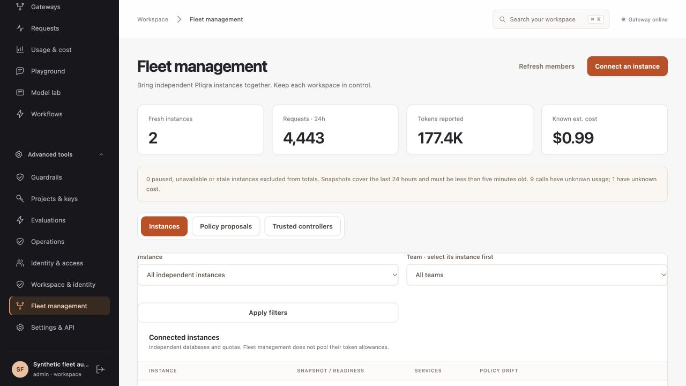
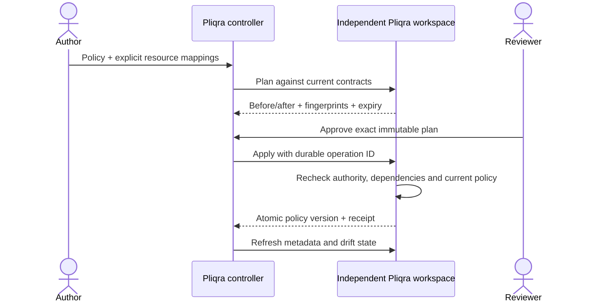
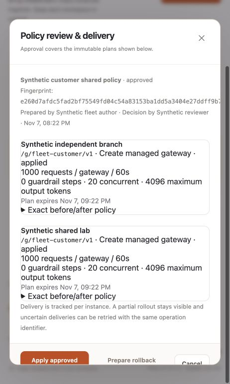

# Manage independent Pliqra installations

[← Pliqra](../README.md)

**Fleet** gives administrators one view of independent workspaces and a reviewed path for distributing gateway rules. Every Pliqra installation includes the controller and member APIs; no sidecar, Kubernetes operator or additional control-plane service is required. Open **Fleet** in the administration console or use the API.

## Connect → map → review → apply

1. In each member's **Fleet → Trusted controllers**, create a pairing. Metadata access is the default; enable policy management explicitly and choose an address prefix such as `fleet-`. Copy the token shown once.
2. In the controller's **Fleet → Instances**, add the member URL and pairing token. Use HTTPS outside loopback and configure `PLIQRA_CA_BUNDLE` for a private CA. Redirects are rejected. Tokens are encrypted in controller storage and hashed on the member.
3. Prepare a policy in **Policy proposals**. Choose services, quota windows/scopes, concurrency, capabilities and guardrail steps through the form, or start from a local gateway. Map service, project, team and guardrail aliases to each target's local resources.
4. A **different active administrator** reviews the immutable before/after plans and approves their exact fingerprint. The author cannot approve their own proposal. Plans expire after one hour.
5. Apply the approved policy. Each target has its own status and receipt. Conflicts require a new proposal; uncertain delivery can be retried safely with the same operation identifier.

Existing locally managed gateways and gateways owned by a different pairing cannot be overwritten. Local service contracts and guardrail versions are checked again at application time. Changes after planning return a conflict rather than silently accepting a different dependency.

## Combined visibility

The dashboard shows the last 24 hours of requests, input/output tokens, known estimated cost, unknown usage/cost and managed-policy drift. Filter by installation, then by a team in that installation. Team identifiers are qualified by workspace; similarly named teams in different installations are not merged.

Snapshots refresh automatically approximately every minute, or on demand. Paused, failed or snapshots older than five minutes are excluded from totals and remain visible as exclusions. These are rolling, asynchronously collected summaries rather than an exact accounting ledger at one global instant. Detailed request inspection remains in each local workspace. Raw prompts, responses, user records, API keys and provider credentials are not included in fleet snapshots. The controller validates a metadata whitelist and discards unexpected fields.

A shared-database multi-DC workspace is registered **once**. Its second ingress address is rejected as a duplicate workspace, preventing double counting. Independent workspaces retain independent databases, keys and quota authorities. Fleet does not turn their quotas into a global admission limit; [multi-DC](MULTI_DC.md) uses a single shared PostgreSQL authority for that purpose.

## Delivery and recovery

- Policy writes, version records, namespace ownership, audit and receipts commit together on each member.
- Delivery has a durable claim; a lost response becomes **unknown**, never a fabricated success. A retry retrieves the committed receipt. Reusing an operation ID with a different plan is rejected.
- Rollout is atomic **per installation**. A partial rollout stays visible and does not imply a distributed all-or-nothing transaction.
- **Prepare rollback proposal** builds fresh plans from the previous configurations. A newly created gateway is disabled, preserving its history. Rollback needs separate approval and fresh dependency checks. Reconcile uncertain targets before rollback.
- Revoke the pairing on the member to stop subsequent access. Rotate by creating a new pairing and updating the controller member credential. Revocation does not erase policies already applied.
- An installation's `workspace_id` persists in backup/restore. Registering a cloned identity as another member is rejected; provision a genuinely new workspace for an independent installation.

## Authority and operating bounds

A policy-enabled pairing delegates gateway configuration authority **within its prefix**. Treat its token as a privileged credential. The two-person review is enforced by the controller's authenticated administrator workflow; the member does not cryptographically attest that two independent humans approved a holder's direct agent API request. Members trust their selected controller. Keep controller administrators, backups and encryption keys under the same protection as other management credentials.

The initial bounds are 50 active pairings per member, 50 controller members, 20 targets per proposal and 500 managed gateways per pairing. Inventory lists expose at most 200 services, guardrails, projects and teams of each kind; `service_total` signals a truncated service inventory. Other IDs can be supplied explicitly through the API. This release does not provide a hosted SaaS control plane, cross-workspace identity provisioning or a global raw-traffic warehouse.

## API map

All `/api/v1/fleet/*` management calls require an administrator session/API authority; browser mutations use the existing CSRF boundary. Agent calls use only the dedicated pairing bearer token.

| Endpoint | Purpose |
|---|---|
| `GET /api/v1/fleet` | Members, proposals and non-secret pairing metadata |
| `POST /api/v1/fleet/trusts`, `DELETE /api/v1/fleet/trusts/{id}` | Create scoped pairing / revoke |
| `POST /api/v1/fleet/members`, `PUT /api/v1/fleet/members/{id}` | Pair, rename, pause or rotate credentials |
| `POST /api/v1/fleet/sync`, `POST /api/v1/fleet/members/{id}/sync` | Refresh snapshots |
| `GET /api/v1/fleet/summary?member_id=…&team_id=…` | Fresh aggregate usage with explicit exclusions |
| `POST /api/v1/fleet/proposals` | Plan portable gateway policy against selected members |
| `POST /api/v1/fleet/proposals/{id}/decision` | Approve/reject exact fingerprint |
| `POST /api/v1/fleet/proposals/{id}/deploy` | Deliver or reconcile uncertain delivery |
| `POST /api/v1/fleet/proposals/{id}/rollback-proposal` | Prepare a reviewed rollback |
| `GET /api/v1/fleet-agent/status` | Scoped metadata snapshot |
| `POST /api/v1/fleet-agent/plan`, `POST /api/v1/fleet-agent/apply` | Member planning and conditional application |

Request schemas are available in `/openapi.json`. [Architecture](ARCHITECTURE.md) · [Synthetic acceptance](ACCEPTANCE.md)
