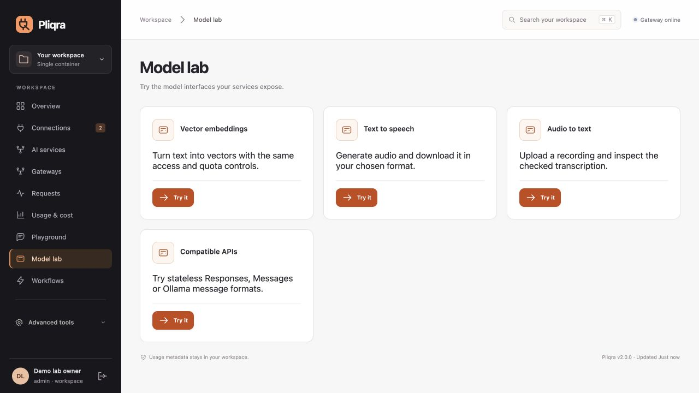

# Model interfaces

Connect an endpoint, select its API format, declare the capabilities that deployment supports, and use **Model lab** to make a call. Declared support and verified response behavior stay distinct. All interfaces use the same scoped identity, gateway policy, admission limits, per-attempt accounting and request history.

| Interface | Routes | Request boundary |
|---|---|---|
| Chat completions | `/v1/chat/completions` | [Typed chat subset](INFERENCE_API.md), tools, JSON Schema, image inputs, checked streaming |
| Embeddings | `/v1/embeddings` | String, string list or token IDs; float/base64 vectors; count/index/dimension/finite-value validation |
| Speech | `/v1/audio/speech` | Text, voice, format, speed and optional instructions; bounded binary response with format-header checks |
| Transcription | `/v1/audio/transcriptions` | Multipart file or JSON `audio_base64` + `filename`; checked JSON/text response |
| Responses | `/v1/responses` | Stateless text/function input and output; text or JSON Schema format |
| Anthropic Messages | `/v1/messages` | Text/image/tool messages; `x-api-key` or Bearer authentication; explicit controls |
| Ollama | `/api/chat`, `/api/generate` | Stateless messages/prompt, tool round trips, supported generation controls, NDJSON delivery |

Named gateways additionally expose `/g/{slug}/v1/embeddings`, `/g/{slug}/v1/audio/speech` and `/g/{slug}/v1/audio/transcriptions`. A policy-bound key enforces its gateway on standard and native routes too. Operations bindings expose `/protocol/v1/bindings/{id}/operations/{embeddings|speech|transcription}` and reject changed contracts before provider access.

Upstream formats are `openai`, `ollama`, `responses` and `anthropic`. Ollama embeddings use `/api/embed`; speech/transcription require an OpenAI-compatible audio provider. Ollama tool objects become JSON argument strings with call identifiers; tool-result messages are mapped back to the native format. Provider-native adapters normalize into the common checked boundary before returning their client format.

## Honest compatibility

Responses/Anthropic client streaming is **buffered** and labeled in `X-Pliqra-Delivery`; it emits native event shapes after full validation. The same applies to these upstream adapters. No native token-stream latency or native-streaming verification is implied. Server-managed conversation IDs, provider-hosted tools, arbitrary unknown fields and training/deployment APIs are unsupported and fail explicitly. This is a documented compatibility subset, not a drop-in implementation of every vendor API.

Audio uploads/responses are bounded at 32 MB. Audio usage is unknown when the provider does not report usable token counts; token reservations remain conservative and price-dependent budgets may reject unpriceable operations. Text guardrails can inspect speech text/instructions and transcription output. A text-only guardrail cannot inspect raw audio or vectors; an incompatible required stage fails closed. Audio header checks establish response shape, not acoustic quality or safety. No raw audio is retained in content capture.

Use actual models to validate quality, tool semantics, supported voices/formats and policy effectiveness in your environment. Automated fixtures are synthetic. See [release evidence](RELEASE.md).

