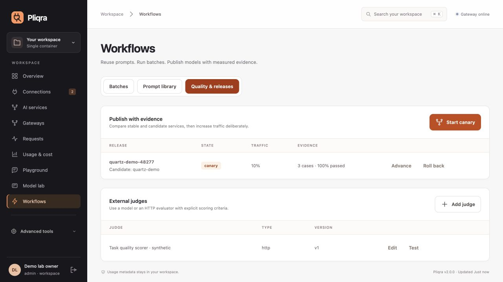

# Prompts, batches and controlled model releases

All controls are in **Workflows**, with matching APIs in the instance's `/openapi.json`.

## Version prompts

Create a project-scoped prompt with ordered messages and named `{{variables}}`. Publishing creates an immutable version; existing callers keep their selected version. Variables are literal data, never executable templates, and missing/extra variables fail validation. Preview and run from the console.

```json
{"model":"support","prompt":{"id":"prompt_ID","version":1,"variables":{"question":"How do I connect?"}},"max_tokens":256}
```

`POST /api/v1/prompts` creates the prompt; `POST /api/v1/prompts/{id}/versions` publishes; `/render` previews. Request evidence records prompt identity/version, while optional content capture follows the service policy.

## Queue durable batches

`POST /api/v1/batches` accepts up to 500 items with `custom_id`, optional `operation` (`chat`, `embeddings`), optional `binding_id`, and `body`. The console converts one input line into one chat/embedding request. Every item passes current authorization, quotas, budgets and guardrails. API keys see only their own batches; administrators see their workspace's batches. Queue admission is bounded to 100 jobs. **Operations → Runtime settings** controls simultaneous jobs (default two).

Requests and optional stored results are encrypted. Inspect progress, retrieve results explicitly, or cancel from the console/API. Result reads are audited. Unstarted work survives restart; running calls become interrupted after lease loss and are never automatically replayed. Cancellation stops new items and requests upstream cancellation, with provider-side cancellation best effort. Rate-limited unstarted items wait safely. Successful items are not repeated. Saved outputs remain until the batch is deleted; disabling result storage still keeps item status and request IDs.

## Judge and gate

Create an LLM-service or HTTP judge with explicit scoring instructions. An HTTP judge returns a finite numeric `score` between 0 and 1 and optional `reason`; unknown/malformed verdicts fail. Model judges use a checked score schema. Credentials are encrypted or secret references. Evaluation results retain judge version, dataset hash and service fingerprints.

In **Evaluations**, compare stable/candidate services on the same cases, select an optional judge and minimum score, and include task assertions. A canary requires fresh completed evidence, enough cases, actual quality assertions, pass-rate/regression gates and optional p95 latency ceiling. Editing the dataset, judge or service invalidates that evidence. Quality scores describe the selected task and evaluator; they do not establish general model safety or correctness.

## Publish a canary

In **Workflows → Quality & releases**, select the stable service, a candidate using distinct deployments, and the comparison. Set the traffic percentage and evidence thresholds. `POST /api/v1/releases` applies the same gates. A shared allocation cursor assigns requests across replicas; request headers/details show the lane. Cache is disabled during canary traffic. Publishing/advancing changes the contract, so bound clients explicitly renew.

Advance traffic deliberately with `/api/v1/releases/{id}/advance`, promote with `/promote` or restore the pre-release service with `/rollback`. These are audited versioned operations. Gates run at publication/advance; continuous autonomous rollout based on live production quality is not implied. Renew applications after each contract change. Keep the comparison and release evidence available for review.


